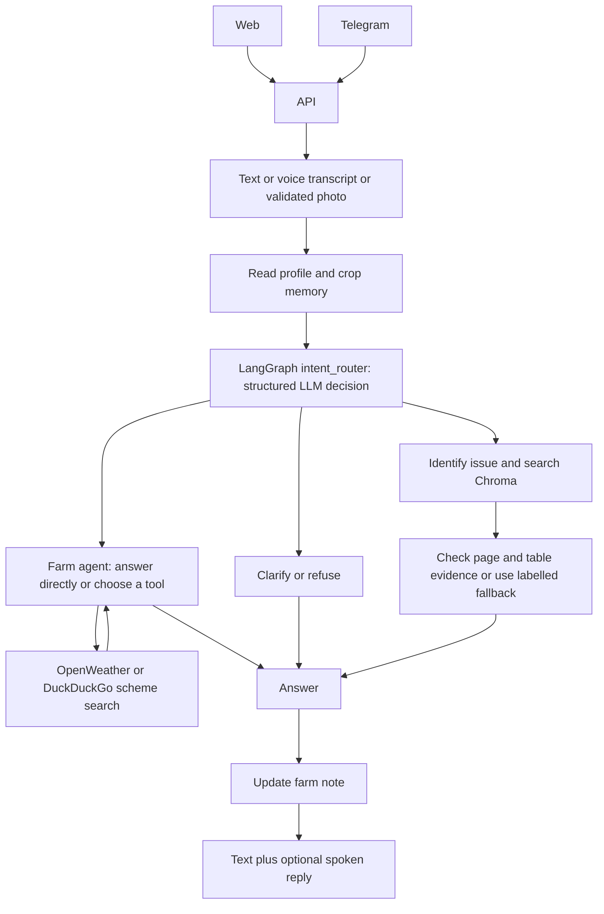

# Request flow

The SQL farm note supplies cross-request continuity; it is not a LangGraph execution checkpoint. Unclear/mismatched photos stop at validation before treatment. Credential checks and upload limits are outside the model's control.
